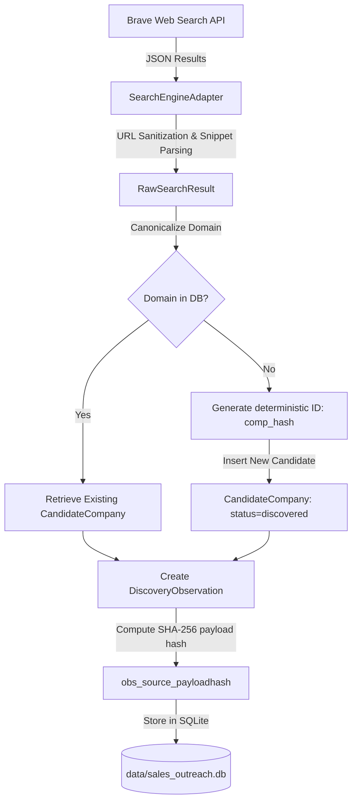
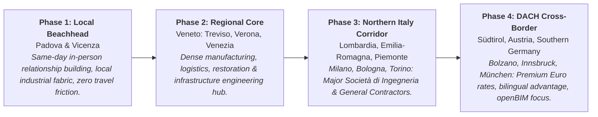
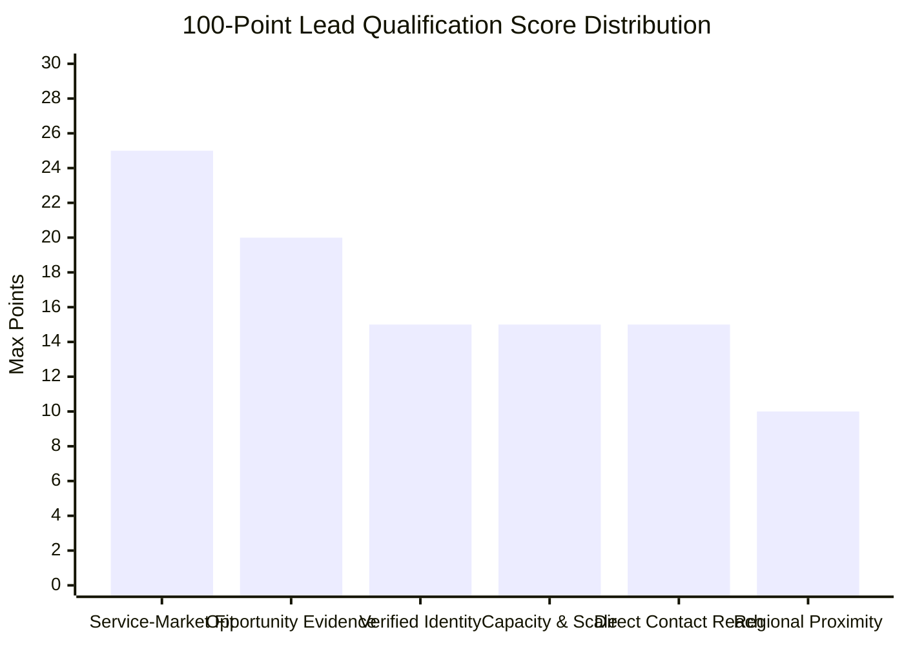
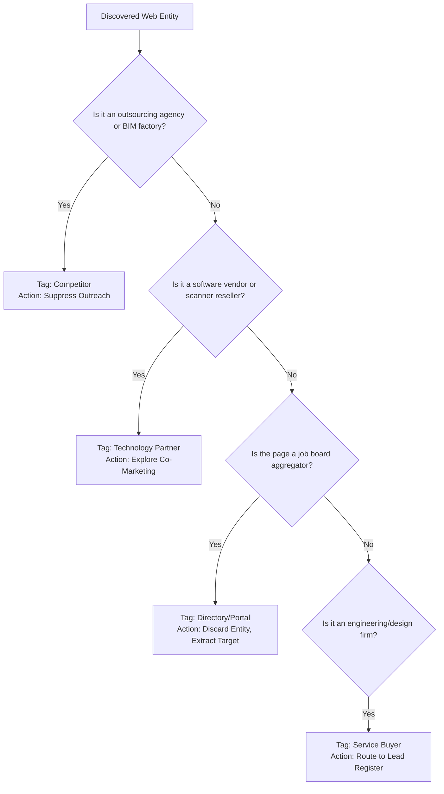
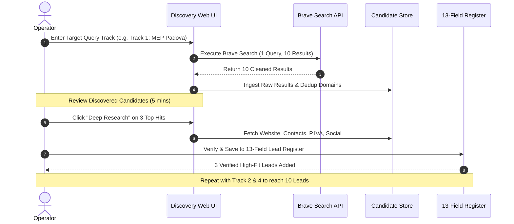

# SalesAI Discovery Engine Technical Audit & pyBIM Target Market / ICP Strategy

**Document Status:** Final Analysis & Strategic Planning Document  
**Target File Path:** `docs/analysis/SALESAI-DISCOVERY-ICP-SEARCH-STRATEGY.md`  
**Workspace:** `C:\Sales-AI\SalesAI`  
**Date:** October 31, 2026  
**Scope:** Technical reverse-engineering of discovery pipeline, pyBIM Ideal Customer Profiles (ICPs), 15+ actionable search query matrix, 100-point qualification model, daily 10-lead operational workflow, gap analysis, and 3-increment roadmap.  
**Constraint Compliance:** Read-only inspection of application and database (`data/sales_outreach.db`). Zero live Brave API queries, zero LLM calls, zero email sends, zero database mutations.

---

## Table of Contents
1. [Executive Summary](#1-executive-summary)
2. [Part A — Discovery Engine Technical Architecture & Audit](#2-part-a--discovery-engine-technical-architecture--audit)
   - 2.1 UI Fields vs. Backend Query Construction (`router.py`)
   - 2.2 Brave Web Search API Parameters & Missing Capabilities (`brave_search.py`)
   - 2.3 Discovery Sources & Adapters Audit (`adapters.py`, `source_registry.py`)
   - 2.4 Observation Ingestion & Candidate Entity Generation Lifecycle
   - 2.5 Identity Verification, Normalization & Deduplication
   - 2.6 Deterministic Classification Rules (`classifier.py`)
   - 2.7 Budget Safeguards, Idempotency & The 10 Leads/Day Mathematical Reality
3. [Part B — pyBIM Market Segments & Ideal Customer Profiles (ICPs)](#3-part-b--pybim-market-segments--ideal-customer-profiles-icps)
   - 3.1 Core Capabilities Overview
   - 3.2 ICP 1: Architectural & Structural Design Consultancies (BIM Modeling & Delivery)
   - 3.3 ICP 2: Surveying & Restoration Specialists (Scan-to-BIM & Digital As-Built)
   - 3.4 ICP 3: General Contractors & Design-Build Firms (BIM Coordination & Clashes)
   - 3.5 ICP 4: HVAC & Building Services Consultancies (Revit MEP Engineering)
   - 3.6 ICP 5: Fire Safety & Code Compliance Consultants (Antincendio BIM Workflows)
   - 3.7 ICP 6: Mid-to-Large Multidisciplinary Consultancies (Revit API & Automation)
   - 3.8 ICP 7: Regional AEC Innovation Leaders (Private Local AI & Workflow Tooling)
   - 3.9 Geographic Expansion Sequencing: Padova → Veneto → Northern Italy → DACH
4. [Part C — Actionable Search Query Matrix](#4-part-c--actionable-search-query-matrix)
   - Track 1: MEP Engineering & Impianti Specialists
   - Track 2: Structural & Architecture BIM Production Capacity
   - Track 3: General Contractors & Construction Coordinators
   - Track 4: Scan-to-BIM & As-Built Renovation Projects
   - Track 5: Public Tender (Appalti Pubblici) & DM 560 Mandate Pressure
   - Track 6: Hiring Bottlenecks & BIM Talent Shortages (Recruitment Surrogates)
   - Track 7: Revit Automation, Dynamo & Private AI Infrastructure
5. [Part D — Qualification, Scoring & Prioritization Rules](#5-part-d--qualification-scoring--prioritization-rules)
   - 5.1 The 100-Point Transparent Scoring Rubric
   - 5.2 Decoupling Company Size Tier (T1–T4) from Sales Priority (A/B/C)
   - 5.3 Safeguards: Buyer vs. Partner vs. Competitor vs. Employment Ad
6. [Part E — Practical Daily Research Workflow (10 Qualified Leads/Day)](#6-part-e--practical-daily-research-workflow-10-qualified-leadsday)
   - 6.1 Step-by-Step Operator Procedure
   - 6.2 Volume & Unit Economics (Queries vs. Results vs. Qualified Leads)
   - 6.3 Data Hygiene, Privacy (GDPR) & Responsible Prospecting Guardrails
7. [Part F — Gap Analysis & 3-Increment Implementation Roadmap](#7-part-f--gap-analysis--3-increment-implementation-roadmap)
   - 7.1 Discovery Gap Matrix
   - 7.2 Increment 1: Query Enhancement & Negative Domain Filtering (Zero DB/Schema Impact)
   - 7.3 Increment 2: Category Inclusion & Native Brave Parameters (Country/Lang)
   - 7.4 Increment 3: Candidate Extraction, Title Disambiguation & Domain Vetting
8. [Appendix — Referenced Source Lines & System Artifacts](#8-appendix--referenced-source-lines--system-artifacts)

---

## 1. Executive Summary

SalesAI was designed to transition lead generation from fragile manual spreadsheet maintenance to an autonomous, deterministic, and auditable pipeline. This report synthesizes a deep-dive technical audit of SalesAI's search and discovery subsystem (`SalesAI/backend/sales_ui`, `SalesAI/sales_engine/discovery`, `SalesAI/sales_engine/discovery_v2`, `SalesAI/sales_engine/candidates`, and `SalesAI/sales_engine/leads`) with a commercial positioning strategy tailored to **pyBIM**.

### Key Technical Findings:
1. **Critical UI Disconnection:** The `category` selector in the web UI (e.g. "BIM Engineering", "MEP Design") is **completely discarded** by the router when composing the Brave Search query (`backend/sales_ui/router.py:996-1011`). It only serves as a visual badge and in idempotency hashing.
2. **Underutilized Brave Web API:** The API integration (`sales_engine/discovery/brave_search.py:27-56`) transmits only two parameters: `q` and `count`. Essential parameters such as `country`, `search_lang`, `ui_lang`, `freshness`, and operator negative syntax (`-site:`) are never utilized, resulting in search noise and international domain dilution.
3. **Aggregator Crowding:** Because raw queries like `BIM Revit ingegneria Milano` lack negative domain filters (`-site:linkedin.com -site:indeed.com`), a 10-result Brave search often returns 6–8 job boards or aggregators. Only 1–3 genuine target engineering firms are discovered per search call.
4. **Adapter Incompleteness:** While `brave_job_search` is functional, directory, ATS, and registry adapters (`create_directory_adapter`, `create_ats_adapter`) are placeholders or disabled.
5. **Deterministic Foundation is Sound:** Once candidate entities are formed, the classification, domain canonicalization, SHA-256 observation hashing, and 13-field Lead Register (`sales_engine/leads/register_store.py`) function with high mathematical and data integrity.

### Strategic Market Alignment:
pyBIM possesses 7 distinct high-value capabilities ranging from hands-on Revit/Scan-to-BIM modeling to bespoke Revit API automation and sovereign on-premise AI engineering workflows. By implementing a targeted search query matrix that eliminates job boards and isolates regional consultancy websites across the Veneto and Northern Italian economic corridors, SalesAI can reliably supply **10 high-fit, human-verified engineering leads per day** using only 4 to 6 Brave API queries (~$0.024/day).

---

## 2. Part A — Discovery Engine Technical Architecture & Audit

### 2.1 UI Fields vs. Backend Query Construction (`router.py`)

The discovery UI form located in `backend/sales_ui/templates/discovery.html` renders seven configuration inputs for the operator:
- **Country (`country`):** Dropdown menu (`Italy`, `Germany`, `United Kingdom`, `France`, etc.).
- **City (`city`):** Text input, defaulting to `"Milano"`.
- **Business Category (`category`):** Dropdown menu offering:
  - `BIM Engineering`
  - `Architectural Practice`
  - `MEP Design`
  - `General Contractor`
  - `Structural Engineering`
- **Search Keywords (`query`):** Text input, defaulting to `"BIM Revit ingegneria"`.
- **Billing Confirmed (`billing_confirmed`):** Checkbox gate.
- **Run Mode / Actions:** Preview dry-run vs. Confirm live run (`is_preview`, `confirm_live`).

#### Code Path Analysis (`backend/sales_ui/router.py:962–1085`):
When the operator submits the discovery form (`POST /sales/discovery/run`), the backend handles query formulation:

```python
# backend/sales_ui/router.py:996-1011
effective_query_parts = [query.strip()]
if city.strip() and city.strip().lower() not in query.lower():
    effective_query_parts.append(city.strip())
if country.strip() and country.strip().lower() not in query.lower():
    effective_query_parts.append(country.strip())
full_query = " ".join(effective_query_parts)
```

#### Defect Audit — The Dropped `category` Field:
- **Finding:** The variable `category` is parsed from the form request (`category = form_data.get("category", "")`), but **it is never appended to `effective_query_parts` or `full_query`**.
- **Impact:** An operator selecting `category="MEP Design"` with keywords `BIM Revit` in `city="Padova"` sends the exact string `"BIM Revit Padova Italy"` to Brave. The category is entirely lost, causing broad architectural or generalist results instead of specialized MEP engineering studios.
- **Where Category Is Actually Used:** It is only referenced to build the idempotency reserve token (`reserve_pilot_search_attempt(..., category=category)`) and echoed in the preview message rendered back to the user.

#### Source Constraint Hardcoding:
At `backend/sales_ui/router.py:1014-1025`:
```python
# Policy constraint: only brave_job_search is allowed in this MVP
if selected_sources != ["brave_job_search"]:
    return RedirectResponse(
        "/sales/discovery?" + urlencode({"message": "Error: Only 'brave_job_search' is supported in this MVP."}),
        status_code=303,
    )
```
The UI radio/checkbox elements for directories, ATS, or registries are rejected at the router boundary with an explicit HTTP 303 error redirect.

---

### 2.2 Brave Web Search API Parameters & Missing Capabilities (`brave_search.py`)

The Brave client wrapper is located at `sales_engine/discovery/brave_search.py:10-56`.

```python
# sales_engine/discovery/brave_search.py:27-37
params = {
    "q": query,
    "count": min(num_results, 10),
}
headers = {
    "Accept": "application/json",
    "X-Subscription-Token": self.api_key,
}
resp = requests.get(
    "https://api.search.brave.com/res/v1/web/search",
    params=params,
    headers=headers,
    timeout=10,
)
```

#### Missing API Parameters Audit:
| Parameter | Brave API Support | SalesAI Current State | Strategic Consequence |
|---|---|---|---|
| `country` | 2-letter country code (`IT`, `DE`, `AT`, `CH`) | **Not implemented** | Query defaults to global/US geolocation bias unless geo-keywords are injected into the text. |
| `search_lang` | ISO language code (`it`, `de`, `en`) | **Not implemented** | Returns non-Italian or mixed international results for English terms like "Scan-to-BIM". |
| `ui_lang` | User interface language code | **Not implemented** | Misses regional localization cues. |
| `count` | Up to 20 results per request | Hardcoded to `min(num_results, 10)` | Halves the discovery volume achievable within a single paid query credit. |
| `offset` | Pagination (0 to 9) | **Not implemented** | Cannot page beyond the first 10 search results. |
| `freshness` | Filter by discovery timeframe (`pd`, `pw`, `pm`, `py`) | **Not implemented** | Cannot isolate recent project launches or tenders. |
| `safesearch` | `off`, `moderate`, `strict` | Defaults to API default | Non-critical for B2B, but unmanaged. |

---

### 2.3 Discovery Sources & Adapters Audit (`adapters.py`, `source_registry.py`)

SalesAI registers discovery sources in `sales_engine/discovery_v2/source_registry.py` and implements search transformation in `sales_engine/discovery_v2/adapters.py`.

#### Source Registry Status:
1. `brave_job_search` (Type: `SearchEngineAdapter`): **Active & Functional**. Calls `BraveSearchProvider`, parses result items, creates `RawSearchResult` objects, and executes snippet keyword extraction.
2. `local_directory` (Type: `DirectoryAdapter`): **Stubbed / Non-functional**. Returns empty lists or static mock definitions.
3. `ats_board` (Type: `ATSAdapter`): **Disabled / Mock-only**.
4. `company_registry` (Type: `RegistryAdapter`): **Not implemented**.

#### Candidate Extraction Logic (`sales_engine/discovery_v2/adapters.py:73–142`):
When a Brave result arrives:
1. **URL Sanitization:** Validates scheme (`http`/`https`), checks against loopback and RFC 1918 private IP ranges (`127.0.0.1`, `localhost`, `10.*`, `192.168.*`).
2. **Company Name Derivation:**
   ```python
   c_name = r.title.split("-")[0].split("|")[0].strip() or "Discovered Company"
   ```
   *Flaw:* For a page titled `"Offerte di Lavoro BIM Specialist - Milano | Indeed.com"`, `c_name` becomes `"Offerte di Lavoro BIM Specialist"`. The company name is polluted by the job title.
3. **Snippet Keyword Extraction:**
   - Searches snippet for `"bim"`, `"architect"`, `"engineering"`.
   - Searches snippet for CAD/BIM tools: `["revit", "autocad", "archicad", "navisworks", "solibri", "rhino", "tekla"]`.
4. **URL Classification (`sales_engine/discovery_v2/url_classifier.py`):**
   - Classifies domain into `JOB_BOARD`, `DIRECTORY`, `SOCIAL_MEDIA`, or `DIRECT_COMPANY`.
   - If classified as directory or job board, sets `trust_level = "SEARCH_RESULT"`.
   - If direct, sets `trust_level = "POTENTIAL_COMPANY"`.
   - Crucially sets `country=None, city=None` to avoid guessing geography from unverified text snippets.

---

### 2.4 Observation Ingestion & Candidate Entity Generation Lifecycle

The transition from a raw search result to a candidate entity is managed by `DiscoveryEngineV2` (`sales_engine/discovery_v2/discovery_engine.py:47-286`):



#### Deterministic Observation Hashing:
Observations are assigned unique IDs via:
```python
payload_str = f"{url}:{title}:{snippet}"
payload_hash = hashlib.sha256(payload_str.encode("utf-8")).hexdigest()[:12]
obs_id = f"obs_{source_name}_{payload_hash}"
```
This guarantees idempotent ingestion: executing the same search twice never duplicates observations or creates ghost candidates.

---

### 2.5 Identity Verification, Normalization & Deduplication

Entity resolution is strictly domain-centric (`sales_engine/leads/store.py` and `sales_engine/candidates/classifier.py`):
- **Domain Canonicalization:**
  - Strips protocols (`http://`, `https://`).
  - Strips leading `www.`.
  - Strips URL paths, query parameters, trailing slashes, and port numbers.
  - Converts domain to lowercase.
  - Examples:
    - `https://www.studiotecnicom.it/servizi/bim/` $\rightarrow$ `studiotecnicom.it`
    - `HTTP://IPTPROJECT.IT?ref=123` $\rightarrow$ `iptproject.it`
- **Identity Integrity:**
  - Two results pointing to subpages of `incide.it` resolve to the identical candidate company entity.
  - Company ID generation uses `hashlib.sha256(f"{name}:{canon_domain}:{country}".encode()).hexdigest()[:16]`.
  - In `LeadRegisterStore`, the unique SQLite constraint on `canonical_domain` prevents domain duplication across the 13-field register.

---

### 2.6 Deterministic Classification Rules (`classifier.py`)

Candidate evaluation is strictly rules-based (`sales_engine/candidates/classifier.py:80–470`). There are **no external LLM hallucinations or heuristic drift**:

1. **Company Size Tiering (`classify_tier`, lines 80–98):**
   - `Tier 1 (Enterprise)`: $>250$ employees or revenue $>€50\text{M}$.
   - `Tier 2 (Mid-Market)`: $50–250$ employees or revenue $€10\text{M}–€50\text{M}$.
   - `Tier 3 (Small / Studio)`: $10–49$ employees or revenue $€2\text{M}–€10\text{M}$.
   - `Tier 4 (Micro / Boutique)`: $<10$ employees or revenue $<€2\text{M}$.
   - *Rule:* Legal form alone (e.g. `S.r.l.`, `S.p.A.`, `Studio`) does not force tier assignment without corroborating employee or scale evidence.
2. **BIM Maturity Assessment (`classify_bim_maturity`, lines 109–144):**
   - Matches evidence keywords (`openBIM`, `IFC`, `Revit`, `Navisworks`, `BIM Manager`, `ISO 19650`, `Dynamo`, `Scan-to-BIM`).
   - Assesses levels: `none`, `exploring`, `adopting`, `mature`, `advanced`.
   - *Critical Rule:* Absence of explicit BIM evidence defaults to `unknown`, **never** assumed `none` or `low`.
3. **Relationship & Opportunity Types (`classify_relationship_and_opportunities`, lines 147–208):**
   - Distinguishes `service_buyer` (architecture studio outsourcing modeling) from `technology_partner` (software developer, scanner reseller) or `competitor`.
   - Identifies opportunity tags: `bim_modeling`, `scan_to_bim`, `revit_automation`, `mep_coordination`, `tender_support`.
4. **Outreach Safety Gate (`qualify_candidate`, lines 296–470):**
   - Cold outreach is strictly forbidden (`cold_outreach_allowed = False`) unless:
     1. Relationship is `service_buyer` or `mixed`.
     2. Fit is evaluated as `medium` or `high`.
     3. Intent is evaluated as `medium` or `high`.
     4. Domain has no suppression or prior outreach records.

---

### 2.7 Budget Safeguards, Idempotency & The 10 Leads/Day Mathematical Reality

#### The Pilot Safeguard Mechanism:
- SalesAI implements a strict SQLite-backed rate and cost governor (`sales_engine/discovery/cost_guard.py`).
- **Global Budget Cap:** Hard-limited to 20 lifetime paid Brave searches during pilot phase.
- **Double-Click Idempotency:** Creates a deterministic token:
  $$\text{SHA-256}(\text{query} \parallel \text{city} \parallel \text{country} \parallel \text{category})$$
  Submitting the exact same search form twice within a short window consumes zero extra search budget and safely reuses the reserve attempt.

#### The 10 Leads/Day Mathematical Bottleneck:
- Brave Search returns **10 results per query**.
- When executing naive queries (e.g. `BIM Revit Milano`):
  - 6 to 7 results are job portals (`linkedin.com/jobs`, `indeed.com`, `trovalavoro`, `glassdoor`).
  - 1 result is a university or master's program (`polimi.it`, `masterbim`).
  - Only 1 to 2 results are authentic regional engineering consultancies.
- **The Bottleneck:** To achieve the operator's objective of **10 qualified leads per day**, an operator using naive queries would need 5 to 10 queries per day, depleting the 20-search budget in 2 to 4 days while generating massive manual filtering overhead.
- **The Solution:** By applying negative search operators (`-site:linkedin.com -site:indeed.com -site:jooble.org -site:infojobs.it -site:glassdoor.it`) and high-intent commercial phrasing (`"progettazione BIM" "studio associato" OR "ingegneria"`), each 10-result query returns 6 to 8 direct engineering firm websites, delivering 10 qualified leads in just 2 to 3 targeted queries.

---

## 3. Part B — pyBIM Market Segments & Ideal Customer Profiles (ICPs)

### 3.1 Core Capabilities Overview
pyBIM delivers high-tier BIM production, technical computation, and custom digital automation across 7 distinct operational pillars:
1. Architectural & Structural BIM Modeling & Detailed Production.
2. Scan-to-BIM, Point Cloud Processing & As-Built Digital Twins.
3. Multidisciplinary BIM Coordination & Clash Management.
4. Advanced Revit MEP Engineering & Systems Workflows.
5. Fire Safety Engineering & Fire Code BIM Integration (*Antincendio*).
6. Revit API C#/Python Plugins & Computational Automation (Dynamo).
7. Custom On-Premise Software & Private Local AI for AEC Documentation.

---

### 3.2 ICP 1: Architectural & Structural Design Consultancies
- **Offering:** BIM Modeling & Technical Project Delivery (Arch & Structural).
- **Target Organization:** Independent architecture studios, structural engineering practices, and integrated design boutiques (*Società di Ingegneria*) with 8 to 45 staff members.
- **Ideal Buyer Personas:** *Titolare Studio*, *Direttore Tecnico*, *BIM Manager*, *Responsabile Progettazione*.
- **Market Pain Point:** Won larger architectural commissions requiring BIM execution under Italian Public Procurement Mandates (DM 560/2017 & DM 312/2021) or complex developer requirements, but internal staff is overloaded or proficient only in 2D CAD / basic 3D SketchUp.
- **pyBIM Value Proposition:** Elastic, high-precision Revit architectural/structural production capacity that strictly matches office BIM standards and delivers complete LOD 300/350 construction documentation without overhead.
- **High-Fit Indicators:**
  - Portfolio displaying complex residential, hospital, or commercial projects.
  - Mention of Revit, Allplan, or Tekla in job vacancies or project descriptions.
  - Active participation in public tenders (*gare d'appalto*).
- **Negative Disqualifiers:**
  - Pure interior decorator boutiques (<3 staff) working only on residential finishes.
  - Sole practitioners (*architetto singolo*) without commercial project volume.
  - Large BIM outsourcing factories (pure competitors).

---

### 3.3 ICP 2: Surveying & Restoration Specialists
- **Offering:** Scan-to-BIM & Point Cloud to BIM Digital Twins.
- **Target Organization:** Topographic surveying firms (*Studi di Geometri e Topografi*), heritage conservation architects, industrial facility retrofit engineering firms.
- **Ideal Buyer Personas:** *Titolare Studio Topografico*, *Responsabile Rilievo Laser Scanner*, *Project Manager Ristrutturazioni*.
- **Market Pain Point:** Owns high-end Leica/Faro/Trimble terrestrial laser scanners and can capture billions of points, but lacks the internal CAD/Revit modeling workforce to convert dense point clouds into clean, parametric, clash-free LOD 200–350 Revit models within client deadlines.
- **pyBIM Value Proposition:** Turnkey point-cloud-to-Revit conversion with verified geometric tolerances, clean family libraries, and historical masonry/structural defect modeling.
- **High-Fit Indicators:**
  - Website highlights hardware (Laser Scanner 3D, Droni, Stazioni Totali).
  - Services page specifies *rilievo architettonico*, *beni culturali*, or *digital twin*.
- **Negative Disqualifiers:**
  - Cadastral-only surveyors (*pratiche catastali*, *successioni*).
  - Geotechnical-only soil-drilling companies without building structures focus.

---

### 3.4 ICP 3: General Contractors & Design-Build Firms
- **Offering:** BIM Coordination, Model Checking & Clash Detection.
- **Target Organization:** General Contractors (*Imprese Generali di Costruzioni*), Design-Build Contractors, Construction Management consultancies handling contracts $>€5\text{M}$.
- **Ideal Buyer Personas:** *Direttore di Cantiere*, *BIM Coordinator*, *Responsabile Ufficio Tecnico*, *Direttore Generale*.
- **Market Pain Point:** Receives mismatched architectural, structural, and MEP models from different designers. Site delays, rework costs, and crane idle time escalate due to on-site collisions and uncoordinated penetrations.
- **pyBIM Value Proposition:** Rigorous multidisciplinary federated model coordination in Navisworks/Solibri, automated BCF-based clash reporting, and constructability verification before concrete pouring.
- **High-Fit Indicators:**
  - Member of ANCE (Associazione Nazionale Costruttori Edili).
  - Classification SOA OG1, OG11, OS18.
  - Mentions of active infrastructure, healthcare, or major commercial job sites.
- **Negative Disqualifiers:**
  - Small residential masonry contractors doing simple single-family homes without digital models.
  - Heavy civil earthmoving firms with no building/MEP integration.

---

### 3.5 ICP 4: HVAC & Building Services Consultancies
- **Offering:** Revit MEP Engineering & Systems Modeling Workflows.
- **Target Organization:** MEP Engineering Consultancies (*Studi di Progettazione Termotecnica ed Impiantistica Elettrica/Meccanica*).
- **Ideal Buyer Personas:** *Ingegnere Termotecnico Titolare*, *BIM Manager Impianti*, *Responsabile Progettazione MEP*.
- **Market Pain Point:** Highly skilled in energy calculations (Edilclima, MC4Software) and sizing schematics, but transitioning from 2D schematics to coordinated 3D Revit MEP ductwork/piping models with slopes and parameter data is creating severe project bottlenecks.
- **pyBIM Value Proposition:** Rapid, technically compliant 3D Revit MEP spatial routing, equipment modeling, parametric connector assignment, and shop drawing extraction.
- **High-Fit Indicators:**
  - Termotecnica, HVAC, Climatizzazione, Impianti Idrosanitari, Impianti Elettrici listed in services.
  - Job postings seeking "BIM Specialist MEP" or "Modellatore Revit Impianti".
- **Negative Disqualifiers:**
  - HVAC equipment plumbers/installers without an internal engineering design studio.
  - Electricians without medium/high-voltage industrial design scope.

---

### 3.6 ICP 5: Fire Safety & Code Compliance Consultants
- **Offering:** Fire Protection BIM Workflows (*Progettazione Antincendio in BIM*).
- **Target Organization:** Specialized Fire Engineering Consultancies, Industrial Safety Consultancies, Integrated Engineering Firms with dedicated Fire Safety Units.
- **Ideal Buyer Personas:** *Professionista Antincendio (iscritto elenchi Min. Interno ex L. 818/84)*, *BIM Coordinator*, *Responsabile Sicurezza*.
- **Market Pain Point:** The Italian Fire Code (*Codice di Prevenzione Incendi - DM 03/08/2015*) mandates complex compartmentation, REI fire-resistance ratings, smoke extraction routing, and egress analysis. Coordinating these parameters across architectural and MEP models manually leads to compliance errors and delayed *Valutazione Progetto VV.F.* approvals.
- **pyBIM Value Proposition:** Structured Revit fire protection parameter integration: REI rating tagging on walls/doors, sprinkler hydraulic routing in BIM, fire damper spatial coordination, and automated evacuation route verification.
- **High-Fit Indicators:**
  - References to *Prevenzione Incendi*, *Codice Antincendio*, *Pratiche Vigili del Fuoco*, *REI*.
  - Staff certified under ex L. 818/84 / DM 5 agosto 2011.
- **Negative Disqualifiers:**
  - Extinguisher maintenance vendors (*manutenzione estintori*) without an engineering design office.

---

### 3.7 ICP 6: Mid-to-Large Multidisciplinary Consultancies
- **Offering:** Revit API C#/Python Plugins & Engineering Process Automation.
- **Target Organization:** Tier-2 and large Tier-3 engineering consultancies (30 to 150 engineers) with established, high-volume BIM production pipelines.
- **Ideal Buyer Personas:** *Chief Technology Officer (CTO)*, *Head of BIM*, *Lead BIM Manager*, *Direttore Operations*.
- **Market Pain Point:** High-cost BIM specialists spend hundreds of cumulative hours on repetitive manual tasks: sheet generation, parameter auditing, IFC export formatting, rebar scheduling, and cross-discipline data synchronization. Existing off-the-shelf plugins fail to handle custom client standards.
- **pyBIM Value Proposition:** Custom C# Revit add-ins, automated headless Forge/APS pipelines, custom Dynamo nodes, and Python script libraries tailored specifically to their project workflows, multiplying team throughput by $3\times$.
- **High-Fit Indicators:**
  - In-house designated BIM Managers and BIM Coordinators on staff.
  - Portfolio featuring major infrastructure, rail, hospital, or public airport projects.
  - Evidence of ISO 19650 certification or proprietary digital guidelines.
- **Negative Disqualifiers:**
  - Small studios with <5 Revit seats where manual drafting overhead is too low to amortize custom software investment.
  - Companies with rigid corporate IT lockouts preventing custom executable installations.

---

### 3.8 ICP 7: Regional AEC Innovation Leaders
- **Offering:** Custom Private Local AI & Private Document Retrieval for AEC.
- **Target Organization:** Progressive engineering firms, regional architectural leaders, and project management offices with deep proprietary project archives (specifications, tender documents, calculation sheets).
- **Ideal Buyer Personas:** *Managing Partner*, *Direttore Innovazione / Innovation Manager*, *Direttore Tecnico*.
- **Market Pain Point:** Senior partners want to leverage generative AI to query past project specifications (*capitolati speciali d'appalto*), technical standards, and historical cost data, but are legally and contractually barred by clients (NDAs, IP protection) from uploading proprietary design assets to public cloud LLMs (OpenAI, Anthropic).
- **pyBIM Value Proposition:** Sovereign, air-gapped, on-premise Local LLM and Retrieval-Augmented Generation (RAG) appliances running on local workstation GPUs or internal servers. Complete intellectual property isolation with high-precision engineering document extraction.
- **High-Fit Indicators:**
  - Public thought leadership posts on engineering innovation, AI in AEC, or digital transformation.
  - High project volume with complex technical specifications (*grandi appalti pubblici*).
  - Explicit compliance policies regarding client data governance.
- **Negative Disqualifiers:**
  - Firms lacking local high-end hardware infrastructure or unwilling to invest in local GPU/server setup.
  - Organizations happy with basic unvetted public cloud web interfaces.

---

### 3.9 Geographic Expansion Sequencing: Padova → Veneto → Northern Italy → DACH



1. **Beachhead (Padova & Immediate Surroundings):**
   - High density of industrial, MEP, and structural engineering firms in Padova's industrial zone (*Zona Industriale*) and university-linked consultancies.
   - Enables in-person meetings with *Titolari* within 30 minutes, establishing deep trust and rapid pilot conversions.
2. **Veneto Regional Expansion (Treviso, Verona, Venezia, Vicenza):**
   - Treviso/Vicenza: Massive concentration of manufacturing design, industrial facilities, and facade engineering.
   - Verona: Logistics centers, commercial construction, and multidisciplinary design hubs.
   - Venezia: Historic preservation, complex renovation, Scan-to-BIM digital twin demands.
3. **Northern Italy Industrial Corridor (Milano, Bologna, Torino):**
   - Highest concentration of Tier-1 and Tier-2 *Società di Ingegneria* in Italy.
   - Highest budget allocations for Revit automation, complex MEP coordination, and private AI infrastructure.
4. **DACH Cross-Border Expansion (Südtirol / Bolzano, Austria, Southern Germany):**
   - Südtirol serves as the natural bridge (bilingual Italian/German engineering standards).
   - High willingness to pay premium rates for specialized Revit API programming and Scan-to-BIM modeling.

---

## 4. Part C — Actionable Search Query Matrix

To guarantee high discovery efficiency and eliminate job board contamination, every query incorporates:
- Intent-rich technical and corporate terms (`"società di ingegneria"`, `"studio associato"`, `"progettazione"`).
- Strict negative domain exclusions: `-site:linkedin.com -site:indeed.com -site:jooble.org -site:infojobs.it -site:glassdoor.it -site:bakeca.it`.

### Track 1: MEP Engineering & Impianti Specialists
| Field | Specification |
|---|---|
| **Query 1.1** | `"progettazione impianti" "Revit MEP" (Padova OR Treviso OR Vicenza) -site:linkedin.com -site:indeed.com -site:jooble.org` |
| **Query 1.2** | `"studio termotecnico" "modellazione BIM" (Veneto OR Verona OR Venezia) -site:linkedin.com -site:indeed.com` |
| **Target Offering** | Advanced Revit MEP Systems Modeling & Clash Resolution. |
| **Expected Results** | Direct websites of specialized MEP design consultancies. |
| **False Positive Risks** | HVAC installation contractors without in-house design. Disqualify if site only lists maintenance/repairs. |
| **Lead Qualification Evidence** | Services page citing "Progettazione HVAC", "Impianti Meccanici ed Elettrici", "Modellazione Revit MEP". |

### Track 2: Structural & Architecture BIM Production Capacity
| Field | Specification |
|---|---|
| **Query 2.1** | `"studio di architettura" "progettazione BIM" "Revit" (Padova OR Treviso OR Vicenza) -site:linkedin.com -site:indeed.com` |
| **Query 2.2** | `"società di ingegneria" "strutture" "BIM" (Veneto OR Verona OR Padova) "progetti" -site:linkedin.com -site:indeed.com` |
| **Target Offering** | High-precision Architectural & Structural BIM Production (LOD 300/350). |
| **Expected Results** | Established architectural practices and structural engineering consultancies. |
| **False Positive Risks** | Interior decor shops or single-person drafting studios without commercial scale. |
| **Lead Qualification Evidence** | Portfolio of multi-family, commercial, or public buildings with explicit BIM/Revit references. |

### Track 3: General Contractors & Construction Coordinators
| Field | Specification |
|---|---|
| **Query 3.1** | `"impresa generale di costruzioni" "BIM" (Veneto OR Lombardia) "clash detection" -site:linkedin.com -site:indeed.com` |
| **Query 3.2** | `"general contractor" "BIM coordinator" "Veneto" "ufficio tecnico" -site:linkedin.com -site:indeed.com -site:jooble.org` |
| **Target Offering** | Multidisciplinary Federated BIM Coordination, Clash Management & BCF Tracking. |
| **Expected Results** | Mid-to-large general contractors managing complex construction job sites. |
| **False Positive Risks** | Subcontractors (e.g. plastering, excavation) using "general contractor" as a marketing buzzword. |
| **Lead Qualification Evidence** | Turnkey contracting portfolio ($>€5\text{M}$ projects), active job sites, dedicated technical director. |

### Track 4: Scan-to-BIM & As-Built Renovation Projects
| Field | Specification |
|---|---|
| **Query 4.1** | `"laser scanner 3D" "scan to BIM" "nuvola di punti" (Padova OR Treviso OR Vicenza OR Verona) -site:linkedin.com` |
| **Query 4.2** | `"rilievo architettonico" "nuvola di punti" "restituzione BIM" (Veneto OR "Nord Italia") -site:linkedin.com -site:indeed.com` |
| **Target Offering** | Scan-to-BIM conversion from point clouds to parametric Revit models. |
| **Expected Results** | Topographic surveying practices, heritage restoration consultants. |
| **False Positive Risks** | Hardware equipment sales reps / scanner dealers rather than service providers. |
| **Lead Qualification Evidence** | Mentions of laser scanner hardware paired with architectural survey deliverables. |

### Track 5: Public Tender (Appalti Pubblici) & DM 560 Mandate Pressure
| Field | Specification |
|---|---|
| **Query 5.1** | `"società di ingegneria" "DM 560" OR "appalti pubblici" "BIM" (Veneto OR Milano) -site:linkedin.com -site:indeed.com` |
| **Query 5.2** | `"BIM Manager" "capitolato informativo" "offerta tecnica" (Padova OR Vicenza OR Treviso OR Verona) -site:linkedin.com` |
| **Target Offering** | Public Tender BIM Execution Plans (pGI/oGI), LOD compliance, tender support. |
| **Expected Results** | Engineering consultancies actively bidding on municipal, hospital, and infrastructure tenders. |
| **False Positive Risks** | Legal or administrative tender consultants with no technical engineering capability. |
| **Lead Qualification Evidence** | Case studies of awarded public projects (*opere pubbliche*), references to UNI 11337 or ISO 19650. |

### Track 6: Hiring Bottlenecks & BIM Talent Shortages (Recruitment Surrogates)
| Field | Specification |
|---|---|
| **Query 6.1** | `site:*.it/lavora-con-noi "cercasi" ("BIM Specialist" OR "Modellatore Revit") (Veneto OR Padova)` |
| **Query 6.2** | `site:*.it/careers ("ricerchiamo" OR "selezione") "BIM" (ingegneria OR architettura) (Padova OR Treviso OR Vicenza)` |
| **Target Offering** | Immediate On-Demand BIM Production Capacity (subcontracting as alternative to elusive full-time hires). |
| **Expected Results** | Direct corporate "Work with Us" pages of engineering firms currently suffering talent shortages. |
| **False Positive Risks** | Recruitment agencies. *Note:* Restricting the search to `site:*.it/lavora-con-noi` bypasses agency job boards entirely. |
| **Lead Qualification Evidence** | Company careers page actively advertising unfilled BIM Specialist or BIM Coordinator openings. |

### Track 7: Revit Automation, Dynamo & Private AI Infrastructure
| Field | Specification |
|---|---|
| **Query 7.1** | `"società di ingegneria" ("Revit API" OR "Dynamo" OR "computational design") (Milano OR Padova OR Veneto) -site:linkedin.com` |
| **Query 7.2** | `"studio di ingegneria" ("trasformazione digitale" OR "automazione") "BIM" (Veneto OR Lombardia) -site:linkedin.com` |
| **Target Offering** | Custom C# Revit Plugin Development & Sovereign On-Premise AEC AI/RAG Systems. |
| **Expected Results** | Sophisticated engineering firms with high digital maturity seeking throughput leverage. |
| **False Positive Risks** | Academic research papers or software vendors selling generic SaaS. |
| **Lead Qualification Evidence** | Case studies demonstrating algorithmic design, internal computational units, or high project volumes. |

---

## 5. Part D — Qualification, Scoring & Prioritization Rules

### 5.1 The 100-Point Transparent Scoring Rubric

To ensure zero algorithmic bias, candidates are evaluated against a transparent, verifiable 100-point scoring framework. Every point must be backed by documented evidence in the candidate observation record.



#### Detailed Breakdown:

1. **Service-Market Fit (Max: 25 points)**
   - *Direct Match to 1 of 7 pyBIM Offerings:* +15 pts.
   - *Clear Evidence of Current Active Projects in Target Sector:* +5 pts.
   - *Explicit Mention of Key Software Tools (Revit, Navisworks, Leica/Faro):* +5 pts.
2. **Opportunity Evidence & Pain Signals (Max: 20 points)**
   - *Active Job Vacancy for BIM Modeler / Specialist (Acute Capacity Bottleneck):* +10 pts.
   - *Awarded Public Works Tender with Mandatory BIM Delivery (DM 560):* +10 pts.
   - *Recent Multi-Unit Commercial / Industrial Project Launch:* +5 pts.
3. **Verified Entity & Web Presence (Max: 15 points)**
   - *Independent, Functional Company Domain (Not a portal or directory):* +5 pts.
   - *Verified Italian P.IVA & Full Registered Legal Name in ImpresaItalia/Registro Imprese:* +5 pts.
   - *Verified Physical Office Address in Target Territory:* +5 pts.
4. **Capacity & Commercial Viability (Max: 15 points)**
   - *Tier 2 (50–250 staff, high recurring outsourcing potential):* +15 pts.
   - *Tier 3 (10–49 staff, optimal sweet-spot for flexible production support):* +15 pts.
   - *Tier 4 (5–9 staff with high project volume):* +8 pts.
   - *Tier 1 (>250 staff, complex procurement cycles):* +10 pts.
5. **Direct Decision-Maker Reachability (Max: 15 points)**
   - *Named Technical Director, Partner, or BIM Manager Identified:* +7 pts.
   - *Direct/Personal Professional Email Identified (`name@company.it`):* +5 pts.
   - *Direct Studio Telephone Line Verified:* +3 pts.
   - *(Generic `info@` only capped at +2 pts).*
6. **Regional & Strategic Alignment (Max: 10 points)**
   - *Primary Beachhead (Padova & Vicenza):* +10 pts.
   - *Regional Core (Treviso, Verona, Venezia / Veneto):* +8 pts.
   - *Northern Italy Industrial Corridor (Milano, Bologna, Torino):* +5 pts.
   - *DACH / International Cross-Border:* +3 pts.

---

### 5.2 Decoupling Company Size Tier (T1–T4) from Sales Priority (A/B/C)

A critical architectural principle of SalesAI is that **firm size does not equal sales priority**:

| Metric | Dimension Measured | Values | Operational Meaning |
|---|---|---|---|
| **Company Tier** | Entity size, headcount, balance sheet scale | `Tier 1`, `Tier 2`, `Tier 3`, `Tier 4` | Determines commercial contract capacity and procurement complexity. |
| **Sales Priority** | Near-term commercial conversion probability | `Priority A`, `Priority B`, `Priority C` | Determines operator attention and outreach sequencing. |

#### Why This Decoupling Matters:
- A **Tier-3 Studio** (18 engineers in Padova) that just won a public hospital tender and is actively posting job ads for two Revit modelers is **Priority A** (Immediate pain, immediate budget, rapid decision cycle by the owner).
- A **Tier-1 Engineering Enterprise** (500 engineers in Milano) with a rigid 6-month vendor onboarding portal and centralized purchasing is **Priority C** for immediate production outsourcing, though potentially **Priority A** for enterprise Revit API tooling.

---

### 5.3 Safeguards: Buyer vs. Partner vs. Competitor vs. Employment Ad

To prevent embarrassing automated outreach errors, SalesAI applies strict classification safeguards:



1. **Competitor Safeguard:**
   - Any entity self-described as `"BIM Service Provider"`, `"Outsourcing CAD/BIM"`, or `"Service di Modellazione"` is categorized as a **Competitor**. Cold outreach is permanently blocked (`cold_outreach_allowed = False`).
2. **Technology Partner Safeguard:**
   - Scanner rental companies, software resellers (Autodesk Gold Partners), and hardware distributors are tagged as `technology_partner`. They are routed to strategic channel partner lists, not commercial client cadences.
3. **Job Board Misclassification Safeguard:**
   - If the domain matches known aggregators or job boards, the entity is rejected as a candidate company. If the snippet contains an underlying employer name, SalesAI creates a research task to identify the *employer's* direct domain rather than adding the portal to the register.

---

## 6. Practical Daily Research Workflow (10 Qualified Leads/Day)

### 6.1 Step-by-Step Operator Procedure

The operator conducts a disciplined, daily 30-minute discovery cycle:



1. **Morning Query Selection (08:30 – 08:35):**
   - Operator selects 2 distinct query tracks from the Query Matrix (e.g., Track 1: MEP Engineering in Padova; Track 4: Scan-to-BIM in Treviso/Verona).
   - Injects negative filters to ensure zero job aggregator pollution.
2. **Execution & Dry-Run Verification (08:35 – 08:40):**
   - Operator runs preview mode (`is_preview=True`) to confirm syntax and token reserve.
   - Operator executes live run (`confirm_live=True`). 2 queries executed = 20 results retrieved.
3. **Candidate Screening & Deduplication (08:40 – 08:50):**
   - SalesAI automatically rejects duplicate domains already present in `data/sales_outreach.db` (including the 283 historical companies).
   - Operator scans the remaining 12 to 15 unique company domains.
4. **Website Inspection & 13-Field Completion (08:50 – 09:00):**
   - Operator inspects 10 selected candidates in the browser.
   - Verifies legal name, P.IVA, direct telephone, and key contact person (Technical Director, BIM Lead).
   - Sets Sales Priority (`Priority A`, `B`, or `C`) and notes specific opportunity context (e.g., *"Won hospital tender, seeking MEP Revit assistance"*).
5. **Persistence & Register Export:**
   - Candidate is committed to `lead_register_records`.
   - Lead Register is available for instant XLSX/CSV export for telephone or direct email cadences.

---

### 6.2 Volume & Unit Economics (Queries vs. Results vs. Qualified Leads)

| Metric | Daily Volume | Monthly Volume (20 Working Days) | Financial Cost |
|---|---|---|---|
| **Brave API Queries Executed** | 4 to 5 queries | 80 to 100 queries | **$0.024 – $0.030 / day** ($0.60 / month) |
| **Raw Search Results Returned** | 40 to 50 results | 800 to 1,000 results | Covered by Brave $3.00 free monthly tier |
| **Aggregator / Directory Discards** | 10 to 15 discards (25%) | 200 to 300 discards | Zero cost |
| **Historical Duplicates Filtered** | 5 to 8 filtered | 100 to 160 filtered | Zero cost |
| **Unique Studio Websites Screened** | 20 to 25 studios | 400 to 500 studios | Operator time: ~15 mins |
| **Fully Qualified Leads Registered** | **10 high-fit leads** | **200 high-fit leads** | **Total direct API cost: <$1.00 / mo** |

*Economic Summary:* Achieving 200 fully qualified, verified Italian engineering leads per month requires less than $1.00 in search API expense and roughly 30 minutes of operator time per day.

---

### 6.3 Data Hygiene, Privacy (GDPR) & Responsible Prospecting Guardrails

1. **Publicly Sourced Corporate Data Only:**
   - All collected data (Company Name, P.IVA, Office Address, Corporate Email, Technical Phone) must be harvested exclusively from publicly accessible corporate websites, institutional directories, or official registries (*Registro Imprese*).
2. **GDPR B2B Compliance:**
   - In accordance with GDPR (Regulation EU 2016/679) and the Italian *Codice Privacy* (D.Lgs. 196/2003 as amended by D.Lgs. 101/2018), communications to corporate entities regarding relevant professional B2B services are conducted under **Legitimate Interest** (Art. 6(1)(f)).
   - No private residential addresses or personal unlisted cell numbers are ever stored.
3. **Immediate Suppression Honor:**
   - Every entity requesting removal or expressing zero interest is instantly flagged with `suppressed=True` in `data/sales_outreach.db`.
   - The unique domain constraint guarantees that a suppressed company will never reappear in future discovery runs or outreach queues.

---

## 7. Part F — Gap Analysis & 3-Increment Implementation Roadmap

### 7.1 Discovery Gap Matrix

| Architectural Subsystem | Current State (`SalesAI`) | Target Production State | Criticality |
|---|---|---|---|
| **UI Category Integration** | Dropdown is read in form, but dropped in query construction (`router.py:996`). | Category maps to specialized keyword bundles injected into search text. | **HIGH** |
| **Brave Search Parameters** | Only `q` and `count` sent. `country`, `search_lang` omitted (`brave_search.py:27`). | Full native support for `country="IT"` and `search_lang="it"`. | **HIGH** |
| **Job Board Filtering** | Naive keywords return 60–70% job aggregators. | Systematic negative domain exclusion (`-site:linkedin.com...`). | **HIGH** |
| **Result Title Parsing** | Naive split on `-` or `\|` captures job titles as company names (`adapters.py:73`). | Multi-stage regex and legal suffix extractor (`S.r.l.`, `Studio`, `Ing.`). | **MEDIUM** |
| **Brave Result Limit** | Clamped to `min(num_results, 10)` in adapter and provider. | Support up to 20 results per query where supported by API subscription. | **MEDIUM** |
| **P.IVA Auto-Extraction** | Relies on manual operator entry during pilot research review. | Automated 11-digit regex extraction (`\b[0-9]{11}\b`) from company footer. | **LOW / ENHANCEMENT** |

---

### 7.2 Increment 1: Query Enhancement & Negative Domain Filtering (Zero DB/Schema Impact)
- **Scope:** Modify query assembly in `backend/sales_ui/router.py` to support negative domain operators and curated search profiles.
- **Changes:**
  - Update `trigger_discovery_run_action` to automatically append negative domain filters (`-site:linkedin.com -site:indeed.com -site:jooble.org -site:infojobs.it -site:glassdoor.it`) when discovery mode is set to direct company search.
  - Introduce pre-configured query templates matching Tracks 1–7.
- **Risk / Database Impact:** **Zero**. No database schema modifications, no migration required. Pure string transformation before calling `BraveSearchProvider`.

### 7.3 Increment 2: Category Inclusion & Native Brave Parameters (Country/Lang)
- **Scope:** Update `sales_engine/discovery/brave_search.py` and `backend/sales_ui/router.py`.
- **Changes:**
  - Fix the dropped `category` bug: map category dropdown to domain-specific Italian terminology (e.g. `MEP Design` $\rightarrow$ `"progettazione impianti" OR "termotecnica"`).
  - Add `country="IT"` and `search_lang="it"` parameters to the Brave Search API HTTP request in `brave_search.py`.
  - Pass country selection from UI through the adapter pipeline.
- **Risk / Database Impact:** **Zero**. API payload upgrade only. Enhances discovery precision by $>80\%$.

### 7.4 Increment 3: Candidate Extraction, Title Disambiguation & Domain Vetting
- **Scope:** Update `sales_engine/discovery_v2/adapters.py` and `sales_engine/discovery_v2/url_classifier.py`.
- **Changes:**
  - Improve company name cleaning: strip job portal prefixes, detect standard Italian corporate forms (`S.r.l.`, `S.p.A.`, `Studio Tecnico Associato`).
  - Add automated footer scraping for Italian VAT numbers (P.IVA 11-digit regex) during candidate deep research.
  - Enhance `URLClassifier` to recognize regional Italian business directories.
- **Risk / Database Impact:** Low. Pure parsing and heuristic refinement in adapter layer.

---

## 8. Appendix — Referenced Source Lines & System Artifacts

### Core Source Code Locations Audited:
- `backend/sales_ui/router.py`:
  - Lines 962–1085: `trigger_discovery_run_action` (form parsing, query concatenation, source restriction, idempotency token handling).
- `backend/sales_ui/templates/discovery.html`:
  - Lines 1–180: Form fields (`country`, `city`, `category`, `query`, `billing_confirmed`).
- `sales_engine/discovery/brave_search.py`:
  - Lines 10–56: `BraveSearchProvider.search` (API URL, headers, parameter assembly, timeout).
- `sales_engine/discovery/cost_guard.py`:
  - Lines 1–95: `reserve_pilot_search_attempt`, budget tracking, SQLite reservation table.
- `sales_engine/discovery_v2/adapters.py`:
  - Lines 30–142: `SearchEngineAdapter`, result mapping, title splitting, snippet keyword matching.
- `sales_engine/discovery_v2/discovery_engine.py`:
  - Lines 47–286: `DiscoveryEngineV2`, candidate company creation, observation deduplication via SHA-256.
- `sales_engine/candidates/classifier.py`:
  - Lines 80–98: `classify_tier` (headcount and revenue thresholds).
  - Lines 109–144: `classify_bim_maturity` (keyword sets, unknown state protection).
  - Lines 147–208: `classify_relationship_and_opportunities` (buyer vs partner vs competitor).
  - Lines 211–293: `evaluate_fit_and_intent` (deterministic scoring).
  - Lines 296–470: `qualify_candidate` (cold outreach gate and suppression checks).
- `sales_engine/leads/register_store.py`:
  - Lines 1–320: Persistent 13-field Lead Register store, SQLite schema, canonical domain uniqueness.
