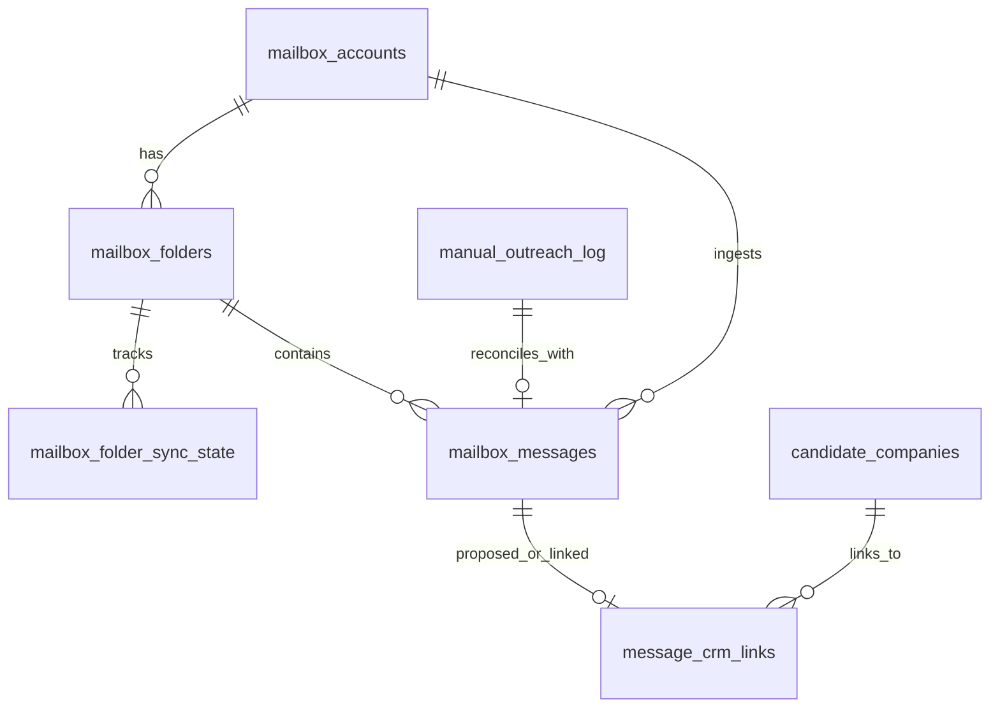
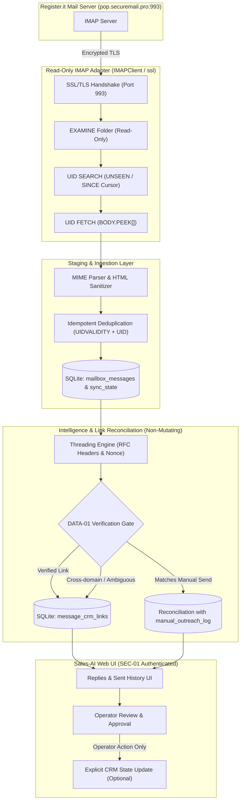

# pyBIM Sales-AI — MAIL-ARCH-01: Register.it Six-Mailbox Integration Architecture

**Document Version:** 1.0.0  
**Status:** DRAFT / PROPOSED ARCHITECTURE  
**Target Repository:** `GeekOfProgramming/Sales-AI`  
**Authorized Branch:** `feature/sales-ai-next-operations`  
**Author:** AI Systems Architect (pyBIM Sales-AI)  
**Date:** 2026-11-15  

---

## Executive Summary

Sales-AI currently operates as the primary operational CRM for company candidate research, 13-field human review, outreach qualification, and external dispatch tracking via Thunderbird (`EMAIL_SEND_ENABLED=false`). Historical emails imported from previous operations (e.g. 609 sent emails) and manual operator outreach events are reconciled and preserved under strict company/contact ownership rules (`DATA-01`).

This document presents the **technical architecture and incremental design** for integrating six authorized Register.it email accounts into Sales-AI via a **strictly read-only IMAP synchronization pipeline**. Thunderbird remains the primary client through which human operators compose and dispatch emails. Sales-AI acts as a passive, non-intrusive ingestion and intelligence layer that observes inbound replies and sent messages without modifying mailbox flags, deleting messages, running SMTP dispatch, or executing destructive CRM status mutations.

---

## 1. Existing Environment & Context

### 1.1 Operating Environment & Infrastructure
* **Hosting:** Primary Windows laptop hosting FastAPI/Uvicorn, accessible over trusted private LAN (`LAN-01`).
* **Authentication & Authorization:** Two-user authentication (`SEC-01`) separating `admin` and `operator` roles with cryptographic PBKDF2-SHA256 password hashing, signed session cookies, and audit trails.
* **Database & Backups:** Authoritative SQLite store (`data/sales_outreach.db`) operating in WAL mode, backed up via online SQLite backup API (`BACKUP-01`).
* **Dispatch Model:** `EMAIL_SEND_ENABLED=false`. All outbound email is dispatched by operators via Thunderbird.
* **Historical & Manual Records:**
  * `historical_sent_emails`: 609+ immutable historical outreach records from previous operations.
  * `manual_outreach_log`: Operator confirmations of manual Thunderbird sends.
  * `historical_reconciliation_corrections`: Operator-audited reassignments under strict `DATA-01` anti-cross-domain rules.

### 1.2 Authorized Register.it Accounts
The six authorized organizational mailboxes hosted by Register.it are:
1. `info@pybim.com` *(Pilot mailbox)*
2. `info@pybim.it`
3. `careers@pybim.com`
4. `support@pybim.com`
5. `hamed.sharifi@pybim.it`
6. `hamid.lotfalian@pybim.it`

**Target IMAP Configuration:**
* **Host:** `pop.securemail.pro` (Standard Register.it secure mail endpoint)
* **Port:** `993`
* **Security:** Implicit SSL/TLS (`ssl.create_default_context()`)
* **Username:** Full email address
* **Password:** Dedicated mailbox password (managed outside Git)

---

## 2. Component Inspection & Reusability Audit

We inspected the current implementation on branch `feature/sales-ai-next-operations`:

| Component / File | Current Status & Capabilities | Reusability Assessment | Required Architectural Modifications |
| :--- | :--- | :--- | :--- |
| **`sales_engine/inbox/providers/base.py`** | Defines `BaseMailboxProvider`, `ProviderSyncBatch`, `ProviderSendResult`. | **Partial** | Must deprecate or fail-closed `send_reply()` for read-only IMAP. Needs folder listing and UID fetch contracts. |
| **`sales_engine/inbox/providers/imap.py`** | Basic skeleton reading `IMAP_HOST`, `IMAP_USER`, `IMAP_PASSWORD` from environment. Only returns empty sync batches. | **Stub** | Replace with robust, read-only `RegisterItReadOnlyIMAPProvider` supporting multi-account credentials, folder inspection, UIDVALIDITY, and bounded `BODY.PEEK`. |
| **`sales_engine/inbox/models.py`** | Models `InboundMessage`, `Conversation`, `ConversationEvent`, `ReplySuggestion`, `MeetingProposal`. | **High (Extend)** | Add `MailboxAccount`, `MailboxFolder`, and `MailboxMessageSyncRecord`. Split message direction (`inbound` vs `outbound_observed`). |
| **`sales_engine/inbox/store.py`** | Tables for `mailbox_connections`, `mailbox_sync_state`, `inbound_messages`, `conversations`. | **High (Extend)** | Extend schema to support multi-account cursors (`account_id` + `folder_name`), message evidence staging, and IMAP UID tracking. |
| **`sales_engine/inbox/sync.py`** (`InboxSyncManager`) | Orchestrates sync, threading, classification, and CRM mutation. | **High Risk** | **CRITICAL:** Currently mutates `candidate_companies` (sets `suppressed=1`, `active_conversation=1`, `cold_outreach_allowed=0`). Ingestion must be completely decoupled from CRM mutations. |
| **`sales_engine/inbox/threading.py`** (`ThreadMatcher`) | Matches messages by Provider Thread ID, In-Reply-To, References, and recipient/subject heuristics. | **Medium (Refactor)** | Strengthen to prevent cross-domain links. Integrate `DATA-01` verified contacts and explicit alias matching. |
| **`backend/sales_inbox_api.py`** | Single-provider mock/gmail/graph endpoints. | **Medium (Extend)** | Introduce account-scoped endpoints, admin-only credential management, and read-only diagnostics. |

---

## 3. Critical Safety Risks & Architectural Guardrails

### 3.1 P0 Risk: Automatic CRM Status Mutation during Ingestion
**Identified Flaw:** Lines 233-298 in `sales_engine/inbox/sync.py` execute direct database updates on `candidate_companies` whenever a message is classified (e.g. marking companies as `suppressed=1` or `cold_outreach_allowed=0`).  
**Guardrail:** We institute an **Ingestion/Staging Barrier**. Ingestion into `mailbox_messages` must be an immutable recording of raw email evidence. No CRM table (`candidate_companies`, `candidate_contacts`, `drafts`) may be modified during IMAP fetch. Thread linking and reply suggestion generation are staged as proposals requiring operator review or explicit policy gates.

### 3.2 P0 Risk: Accidental Mailbox Alteration or Deletion
**Identified Flaw:** Standard IMAP client libraries permit flags like `\Seen` or `\Deleted` to be set during fetch.  
**Guardrail:**
* Folders are selected using `EXAMINE` (Read-Only) instead of `SELECT`.
* Body contents are fetched using `BODY.PEEK[]` or `BODY.PEEK[HEADER.FIELDS ...]` to prevent marking unread messages as read.
* Commands `STORE`, `EXPUNGE`, `APPEND`, `COPY`, and `MOVE` are strictly prohibited in the adapter code.
* `send_reply` raises `NotImplementedError("IMAP provider is strictly read-only; outbound sending is disabled")`.

### 3.3 P0 Risk: Cross-Domain Historical Mis-attribution (`DATA-01`)
**Identified Flaw:** If an inbound email mentions a domain or third party, heuristic matching might link it to an unrelated candidate.  
**Guardrail:** Strict adherence to `DATA-01`. Linking requires:
1. Exact RFC `In-Reply-To` or `References` pointing to a known `manual_outreach_log` or `send_attempts` message ID.
2. Verified recipient email belonging to the candidate company's registered domain or approved domain alias.
3. If ambiguous, the message is marked `review_required` and never linked automatically.

---

## 4. Minimum Data Model Changes (Schema Design)

The database schema is extended incrementally without dropping existing tables or records.



### 4.1 Table: `mailbox_accounts`
Stores configuration and status for the six mailboxes. Passwords are never stored here.

```sql
CREATE TABLE IF NOT EXISTS mailbox_accounts (
    account_id TEXT PRIMARY KEY,               -- e.g. 'acc_info_pybim_com'
    email_address TEXT NOT NULL UNIQUE,       -- 'info@pybim.com'
    display_name TEXT NOT NULL,               -- 'pyBIM Info (COM)'
    provider TEXT NOT NULL DEFAULT 'register_it',
    imap_host TEXT NOT NULL DEFAULT 'pop.securemail.pro',
    imap_port INTEGER NOT NULL DEFAULT 993,
    use_ssl INTEGER NOT NULL DEFAULT 1,
    credential_ref TEXT NOT NULL,             -- Key name in Windows Credential Manager / protected secret store
    is_enabled INTEGER NOT NULL DEFAULT 1,
    sync_priority INTEGER NOT NULL DEFAULT 10,
    created_at TEXT NOT NULL,
    updated_at TEXT NOT NULL
);
```

### 4.2 Table: `mailbox_folders`
Tracks discovered IMAP folders per account without assuming localized names.

```sql
CREATE TABLE IF NOT EXISTS mailbox_folders (
    folder_id TEXT PRIMARY KEY,               -- e.g. 'fld_acc_info_com_inbox'
    account_id TEXT NOT NULL,
    folder_name TEXT NOT NULL,                -- e.g. 'INBOX', 'Sent', 'Posta Inviata'
    folder_delimiter TEXT NOT NULL DEFAULT '/',
    folder_type TEXT NOT NULL DEFAULT 'other', -- 'inbox', 'sent', 'drafts', 'archive', 'trash', 'other'
    is_active INTEGER NOT NULL DEFAULT 1,
    last_uidvalidity INTEGER,
    last_seen_uid INTEGER DEFAULT 0,
    created_at TEXT NOT NULL,
    updated_at TEXT NOT NULL,
    FOREIGN KEY (account_id) REFERENCES mailbox_accounts(account_id) ON DELETE CASCADE,
    UNIQUE(account_id, folder_name)
);
```

### 4.3 Table: `mailbox_folder_sync_state`
Maintains individual sync cursors per folder, ensuring interruption recovery and idempotency.

```sql
CREATE TABLE IF NOT EXISTS mailbox_folder_sync_state (
    sync_state_id TEXT PRIMARY KEY,
    account_id TEXT NOT NULL,
    folder_id TEXT NOT NULL,
    uidvalidity INTEGER NOT NULL,
    highest_modseq INTEGER,
    last_synced_uid INTEGER NOT NULL DEFAULT 0,
    last_sync_started_at TEXT,
    last_sync_completed_at TEXT,
    last_status TEXT NOT NULL DEFAULT 'idle', -- 'idle', 'syncing', 'success', 'failed'
    messages_fetched_total INTEGER DEFAULT 0,
    last_error_message TEXT,
    retry_count INTEGER DEFAULT 0,
    FOREIGN KEY (account_id) REFERENCES mailbox_accounts(account_id) ON DELETE CASCADE,
    FOREIGN KEY (folder_id) REFERENCES mailbox_folders(folder_id) ON DELETE CASCADE,
    UNIQUE(account_id, folder_id)
);
```

### 4.4 Table: `mailbox_messages` (Immutable Ingestion Layer)
Captures raw email evidence without triggering CRM mutations.

```sql
CREATE TABLE IF NOT EXISTS mailbox_messages (
    message_id TEXT PRIMARY KEY,              -- 'msg_<sha256_hash_of_account_folder_uid>'
    account_id TEXT NOT NULL,
    folder_id TEXT NOT NULL,
    folder_type TEXT NOT NULL,
    direction TEXT NOT NULL,                  -- 'inbound', 'outbound'
    imap_uid INTEGER NOT NULL,
    imap_uidvalidity INTEGER NOT NULL,
    rfc_message_id TEXT,                      -- Extracted Internet-Message-ID (<...>)
    in_reply_to TEXT,
    references_json TEXT DEFAULT '[]',
    from_address TEXT NOT NULL,
    from_name TEXT,
    to_addresses_json TEXT NOT NULL DEFAULT '[]',
    cc_addresses_json TEXT DEFAULT '[]',
    bcc_addresses_json TEXT DEFAULT '[]',
    subject TEXT,
    date_utc TEXT NOT NULL,
    body_plain_text TEXT,
    body_html_sanitized TEXT,
    has_attachments INTEGER DEFAULT 0,
    attachments_meta_json TEXT DEFAULT '[]',
    raw_headers_json TEXT,
    ingested_at TEXT NOT NULL,
    FOREIGN KEY (account_id) REFERENCES mailbox_accounts(account_id) ON DELETE CASCADE,
    FOREIGN KEY (folder_id) REFERENCES mailbox_folders(folder_id) ON DELETE CASCADE,
    UNIQUE(account_id, folder_id, imap_uidvalidity, imap_uid)
);

CREATE INDEX IF NOT EXISTS idx_mb_msg_rfc ON mailbox_messages(rfc_message_id);
CREATE INDEX IF NOT EXISTS idx_mb_msg_irt ON mailbox_messages(in_reply_to);
CREATE INDEX IF NOT EXISTS idx_mb_msg_from ON mailbox_messages(from_address);
CREATE INDEX IF NOT EXISTS idx_mb_msg_date ON mailbox_messages(date_utc DESC);
```

### 4.5 Table: `message_crm_links` (Separation of CRM Policy)
Separates the raw ingested message from its candidate company association.

```sql
CREATE TABLE IF NOT EXISTS message_crm_links (
    link_id TEXT PRIMARY KEY,
    message_id TEXT NOT NULL,
    candidate_id TEXT,                        -- NULL if unlinked / external
    contact_id TEXT,
    link_status TEXT NOT NULL,                -- 'verified', 'suggested_pending_review', 'unlinked', 'rejected'
    link_method TEXT NOT NULL,                -- 'rfc_in_reply_to', 'manual_outreach_match', 'contact_email', 'manual_operator'
    link_confidence REAL NOT NULL,
    evidence_summary TEXT,
    verified_by TEXT,
    verified_at TEXT,
    created_at TEXT NOT NULL,
    FOREIGN KEY (message_id) REFERENCES mailbox_messages(message_id) ON DELETE CASCADE,
    FOREIGN KEY (candidate_id) REFERENCES candidate_companies(candidate_id)
);
CREATE INDEX IF NOT EXISTS idx_mcl_cand ON message_crm_links(candidate_id);
CREATE INDEX IF NOT EXISTS idx_mcl_status ON message_crm_links(link_status);
```

---

## 5. End-to-End Data Flow Architecture

The data flow enforces clear separation between transport ingestion, evidence persistence, and business logic linking:



---

## 6. Read-Only IMAP Adapter Contract

The provider implementation will inherit from an enhanced base class:

```python
class ReadOnlyMailboxProvider(ABC):
    """Strictly read-only IMAP provider interface."""

    @abstractmethod
    def list_folders(self, account: MailboxAccount) -> List[MailboxFolder]:
        """Discover available remote folders via IMAP LIST without selecting them."""
        pass

    @abstractmethod
    def fetch_folder_messages(
        self,
        account: MailboxAccount,
        folder: MailboxFolder,
        since_uid: int,
        batch_size: int = 50,
    ) -> FolderFetchBatch:
        """
        Examine folder read-only, search UIDs > since_uid, and fetch message headers/bodies
        using BODY.PEEK. Never modify flags.
        """
        pass

    def send_reply(self, *args, **kwargs):
        raise NotImplementedError("ReadOnlyMailboxProvider does not permit sending.")
```

**Technical Guarantees:**
1. **EXAMINE Mode:** Always issue `EXAMINE <folder>` (read-only mode), never `SELECT`.
2. **BODY.PEEK:** Always use `RFC822.PEEK` or `BODY.PEEK[]`. This guarantees that unread messages in Register.it remain unread for Thunderbird operators.
3. **Socket Timeout:** All socket operations set an explicit timeout (e.g. 20.0 seconds).
4. **Clean Disconnect:** Always issue `CLOSE` and `LOGOUT` in `finally` blocks.

---

## 7. Account/Folder Synchronization & Deduplication Strategy

### 7.1 Multi-Folder Discovery & Classification
* Remote folder names vary across webmail, Thunderbird, and IMAP servers (e.g. `INBOX`, `Sent`, `Sent Messages`, `Posta Inviata`, `Bozze`).
* The adapter discovers folders via IMAP `LIST "" "*"` and parses folder flags (`\Sent`, `\Drafts`, `\Trash`, `\Inbox`, `\All`).
* If flags are absent, fallback regex pattern matching categorizes folder types without hardcoding English assumptions.

### 7.2 UIDVALIDITY & Interruption Recovery
* IMAP UIDs are guaranteed unique and strictly increasing *only within a given `UIDVALIDITY`*.
* If Register.it resets `UIDVALIDITY` (e.g. mailbox rebuild), the sync manager detects the change:
  1. Flags existing folder sync state as `uidvalidity_invalidated`.
  2. Resets the cursor to 0.
  3. Re-fetches messages using RFC `Message-ID` deduplication to prevent duplicate records in SQLite.
* During normal runs, the cursor progresses monotonically: `UID SEARCH UID (last_synced_uid + 1):*`.

### 7.3 Cross-Folder and Cross-Account Deduplication
* If an email is copied to both `Sent` and an archive folder, or sent across multiple PyBIM accounts (e.g. `To: hamed.sharifi@pybim.it`, `Cc: hamid.lotfalian@pybim.it`), each physical mailbox/folder receives its own immutable record in `mailbox_messages` with its respective `(account_id, folder_id, imap_uid)`.
* For CRM representation and conversation threading, messages sharing the same `rfc_message_id` are grouped under a single logical thread, preserving provenance without duplicating conversation entries.

---

## 8. CRM & Historical Email Reconciliation Policy

### 8.1 Reconciling Manual Outreach (`manual_outreach_log`)
When operators send emails via Thunderbird, they click "Mark as Sent" in Sales-AI, creating a record in `manual_outreach_log`.
When the IMAP adapter scans the `Sent` folder:
1. It compares the outbound recipient, timestamp, and normalized subject against unverified records in `manual_outreach_log`.
2. Upon finding a match, it updates `manual_outreach_log`:
   * `imap_reconciliation_status = 'confirmed_on_server'`
   * `imap_message_id = rfc_message_id`
   * `imap_uid = uid`
   * `imap_matched_at = CURRENT_TIMESTAMP`
3. This provides **authoritative server-side verification** that the operator's manual Thunderbird send was successfully transmitted.

### 8.2 Historical Sent Emails (`historical_sent_emails`)
* The 609+ existing historical records originated from Google Sheets / Gmail exports.
* Newly synced messages from Register.it will **never overwrite, renumber, or delete** rows in `historical_sent_emails`.
* If a synced message corresponds to an existing historical message (matched by normalized RFC `Message-ID` or timestamp + recipient), the system establishes an audit link rather than mutating historical rows.

### 8.3 DATA-01 Anti-Cross-Domain Enforcement
Under `DATA-01`, emails sent to or received from a specific domain (e.g. `studio@piuarch.it`) belong strictly to that company candidate (`cand:domain:piuarch.it`).
* **Rule 1:** A message is linked to a candidate company **only** if the sender or recipient email domain matches the company's verified canonical domain or registered alias in `candidate_contact_verifications`.
* **Rule 2:** Subject line similarity alone **never** triggers an automatic link.
* **Rule 3:** Unmatched or ambiguous messages are assigned `link_status = 'unlinked'` or `'suggested_pending_review'` and surfaced in an operator review queue.

---

## 9. Security, Privacy & Credential Handling

### 9.1 Credential Storage on Windows
* **Zero Plaintext in Code/Git/SQLite:** Passwords for the six mailboxes must never be committed to Git, stored in SQLite tables, or displayed in frontend UI.
* **Storage Options:**
  1. **Option A (Recommended for Windows):** Windows Credential Manager via the standard Python `keyring` library (`keyring.set_password("pybim_salesai", account_id, password)`). Credentials are encrypted using DPAPI tied to the Windows user account.
  2. **Option B (File-based Encrypted Store):** An encrypted configuration file (`data/.mailbox_secrets.enc`) protected by a local installation master key (similar to the SEC-01 JWT secret and analysis auth secret), restricted to `0o600`.
* **Frontend Access:** The Web UI displays only masked status: `●●●●●●●● (Configured)`, last sync time, and error indicators.

### 9.2 LAN & Transport Security
* **Register.it Connection:** Strictly port 993 over TLS 1.2+ with full certificate validation (`ssl.CERT_REQUIRED`).
* **LAN Browser Access:** The Sales-AI web UI currently operates over HTTP on the private LAN. To protect mailbox content viewed in the browser:
  * Mailbox administration and credential input must be restricted to `ADMIN` roles.
  * In a subsequent task, TLS termination (HTTPS with self-signed certificate or local CA) will be added to the launcher for multi-laptop LAN security.

### 9.3 Content Handling & Sanitization
* **HTML Sanitization:** Raw email HTML is stripped of tracking scripts, active JavaScript, `iframe`, and remote executable objects before storage, using `bleach` or `nh3`.
* **Attachments:** In Phase 1, attachments are **not downloaded**. Only attachment metadata (filename, content type, byte size) is stored to preserve local disk space.
* **No LLM Auto-Processing:** Inbound mailbox messages are never sent to external LLMs (e.g. Gemini) automatically. LLM analysis remains an explicit, operator-triggered action with budget authorization.

---

## 10. Incremental Pilot Design: `info@pybim.com`

Before rolling out synchronization across all six accounts, a strict single-mailbox pilot must be conducted:

```mermaid
flowchart LR
    A["Operator Authorizes Pilot"] --> B["Configure info@pybim.com in Credential Store"]
    B --> C["Run Discovery (LIST Folders)"]
    C --> D["Sample 10 Messages from INBOX (BODY.PEEK)"]
    D --> E["Sample 10 Messages from Sent"]
    E --> F["Verify Zero Remote Flag Changes"]
    F --> G["Verify Zero CRM Status Changes"]
    G --> H["Repeat Run (Verify Idempotency)"]
```



### 10.1 Pilot Acceptance Criteria
1. **Explicit Operator Authorization:** The pilot runs only after the operator provides credentials for `info@pybim.com`.
2. **Read-Only Verification:** `EXAMINE` and `BODY.PEEK` are confirmed in network logs. Remote `\Seen` flags in Register.it webmail are unchanged.
3. **Folder Discovery:** Discovers the exact folder names for `INBOX` and `Sent`.
4. **Bounded Fetch:** Limits ingestion to a small sample (max 10 messages per folder).
5. **No CRM Mutations:** Verifies that zero records in `candidate_companies` or `candidate_contacts` have altered status, active conversation, or suppression flags.
6. **Idempotent Re-run:** A second synchronization run immediately afterward fetches 0 new messages and creates 0 duplicate records.
7. **Reconciliation Check:** Confirms that any sent messages matching existing `manual_outreach_log` entries update only the verification status.

---

## 11. Multi-Account Rollout Roadmap

Following successful acceptance of the `info@pybim.com` pilot, the remaining accounts will be activated in phased cohorts:

```
Cohort 1 (Pilot):
  └── info@pybim.com          [General inbound & outreach confirmation]

Cohort 2 (Company Inboxes):
  ├── info@pybim.it           [Italian outreach & regional inquiries]
  ├── support@pybim.com        [Customer & technical inquiries]
  └── careers@pybim.com        [Recruiting & incoming CVs]

Cohort 3 (Personal Mailboxes):
  ├── hamed.sharifi@pybim.it   [Founder outreach & direct threads]
  └── hamid.lotfalian@pybim.it [Technical founder outreach & threads]
```

---

## 12. Subsequent Task Breakdown & Acceptance Criteria

To maintain manageable PR sizes and strict testability, the implementation is decomposed into five discrete tasks:

### Task 1: `MAIL-DATA-01` — Mailbox Data Models & SQLite Schema
* **Scope:** Add tables `mailbox_accounts`, `mailbox_folders`, `mailbox_folder_sync_state`, `mailbox_messages`, and `message_crm_links`.
* **Acceptance Criteria:**
  1. SQLite tables created with proper foreign keys and indices.
  2. Pydantic and dataclass models implemented.
  3. Existing tables (`historical_sent_emails`, `manual_outreach_log`, `candidate_companies`) remain completely untouched.
  4. Migration script passes `PRAGMA integrity_check` and `PRAGMA foreign_key_check`.

### Task 2: `IMAP-CONN-01` — Read-Only Register.it IMAP Adapter & Windows Credential Integration
* **Scope:** Implement `RegisterItReadOnlyIMAPProvider` and local secret storage using Windows Credential Manager / DPAPI.
* **Acceptance Criteria:**
  1. SSL/TLS connection established with `pop.securemail.pro:993` with certificate validation.
  2. Strictly read-only: uses `EXAMINE` and `BODY.PEEK[]`.
  3. Calling `send_reply()` raises `NotImplementedError`.
  4. Passwords never appear in logs, exceptions, or database tables.
  5. Comprehensive mock and unit tests verifying socket timeouts and error handling.

### Task 3: `MAIL-LINK-01` — Ingestion Staging & DATA-01 Safe Linker
* **Scope:** Build the non-mutating message staging pipeline and strict RFC header linker.
* **Acceptance Criteria:**
  1. Ingested messages written to `mailbox_messages` without touching CRM tables.
  2. Linking respects `DATA-01`: matches only verified domain contacts or explicit `In-Reply-To` outbound references.
  3. Cross-domain matches are rejected or flagged as `suggested_pending_review`.
  4. Reconciles sent messages with `manual_outreach_log` (`confirmed_on_server`).

### Task 4: `IMAP-SYNC-02` — Resilient Sync Manager & Pilot Execution
* **Scope:** Multi-folder sync orchestration, UIDVALIDITY change detection, cursor progression, and single-account pilot for `info@pybim.com`.
* **Acceptance Criteria:**
  1. Successfully syncs `INBOX` and `Sent` for `info@pybim.com` under operator test credentials.
  2. Idempotency verified: re-running sync produces zero duplicate rows.
  3. Interruption recovery: simulated kill and resume recovers at the last recorded UID.
  4. Zero changes to remote message flags in Register.it.

### Task 5: `MAIL-OPS-01` — Operator UI for Multi-Mailbox Visibility & Reconciled History
* **Scope:** Add read-only mailbox status dashboard, multi-account filters for Sent & History, and operator linking review screen.
* **Acceptance Criteria:**
  1. SEC-01 permissions enforced (Admin can manage accounts; Operator can view mail and review links).
  2. Visual indicator showing server confirmation for Thunderbird sends.
  3. No plain-text passwords visible anywhere in UI or network responses.
  4. Works cleanly over private LAN.

---

## 13. File Change Map & Complexity Estimates

| Component / File Path | Action | Complexity | Dependency |
| :--- | :--- | :--- | :--- |
| `docs/architecture/MAIL-ARCH-01-REGISTER-IT-IMAP.md` | Create | Low | None (Current Task) |
| `sales_engine/inbox/models.py` | Modify | Low | None |
| `sales_engine/inbox/store.py` | Modify | Medium | `models.py` |
| `sales_engine/inbox/credential_store.py` | Create | Medium | `keyring` / DPAPI |
| `sales_engine/inbox/providers/register_it.py` | Create | High | `imaplib` / `ssl` |
| `sales_engine/inbox/staging.py` | Create | Medium | `store.py` |
| `sales_engine/inbox/reconciliation.py` | Create | High | `DATA-01` rules |
| `sales_engine/inbox/sync_service.py` | Create | High | `register_it.py`, `staging.py` |
| `backend/sales_inbox_api.py` | Modify | Medium | `sync_service.py` |
| `backend/sales_ui/templates/inbox_status.html` | Create | Medium | UI templates |
| `tests/test_register_it_imap.py` | Create | High | Mock IMAP server |

---

## 14. Conclusion & Next Steps

This architecture provides a safe, non-destructive bridge connecting pyBIM's six Register.it mailboxes with Sales-AI. By enforcing read-only IMAP operations, separating ingestion evidence from CRM mutations, respecting `DATA-01` cross-domain rules, and protecting credentials via Windows OS-backed storage, the CRM gains full visibility into email history and replies without risking data corruption, remote flag disruption, or manual dispatch conflicts.

Implementation should proceed strictly following the sequential task breakdown starting with **`MAIL-DATA-01`**.
