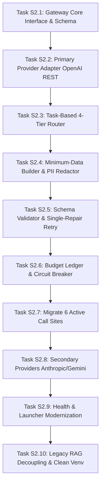

# SalesAI S1 — S2 External LLM Gateway Migration Backlog

**Document Version:** 1.0  
**Date:** 2026-10-21  
**Author:** Antigravity Engineering Agent  
**Base Commit:** `1b6c50e8f1a615cf462bce296b604b69b915d721`  
**Branch:** `audit/salesai-s1-laptop-dependency-map`  
**Target Milestone:** S2 — Remote Multi-Provider External LLM Gateway

---

## 1. Overview & S2 Architectural Vision

The purpose of Phase S2 is replacing the local Ollama dependency (`BIMLLMClient` wrapping `import ollama`) with a clean, extensible, multi-provider **External LLM Gateway** (`LLMProviderGateway`).

The target architecture operates on the developer's laptop, delegating all natural language extraction and generation to commercial remote HTTPS APIs over TLS.

### Core Rules of Engagement for S2:
1. **Incremental Delivery:** Prioritize **one provider first** (OpenAI-compatible REST client via `httpx`) to achieve 100% test parity before staging secondary providers (Anthropic, Google Gemini, Mistral).
2. **No Uncontrolled Automatic Escalation:** When a Tier 1 model fails on a task, it must **never** automatically escalate to an expensive Tier 4 model without explicit operator confirmation or configured rule limits.
3. **Hard Budget & Token Caps:** A strict daily spending limit (default: **$1.00 USD/day**) and monthly limit (default: **$15.00 USD/month**) will prevent unintended billing runaway.
4. **Offline Deterministic Mode:** If offline or if API keys are absent, SalesAI must degrade gracefully to rule-based discovery, template drafts, and heuristic scoring without throwing unhandled exceptions.
5. **Preserve Human Authority:** Never allow LLM outputs to bypass the Phase 9 sending gate or modify CRM status without operator approval.

---

## 2. Ordered S2 Implementation Tasks

### Task S2.1: Unified LLM Gateway Interface & Exception Hierarchy
- **Deliverable:** `sales_engine/llm_gateway/interface.py`
- **Specification:**
  - Define abstract base class `BaseLLMProvider`.
  - Standard request model: `LLMRequest(prompt, system_prompt, schema, temperature, max_tokens, tier, task_id)`.
  - Standard response model: `LLMResponse(content, raw_json, input_tokens, output_tokens, cost_usd, latency_ms, provider, model)`.
  - Standard exception hierarchy: `LLMError`, `LLMTimeoutError`, `LLMQuotaExceededError`, `LLMAuthenticationError`, `LLMInvalidSchemaError`.
- **Exit Criteria:** Unit tests verify interface contracts and exception handling.

### Task S2.2: Primary Remote Adapter (OpenAI-Compatible HTTPS REST)
- **Deliverable:** `sales_engine/llm_gateway/providers/openai_provider.py`
- **Specification:**
  - Lightweight async HTTPS client using `httpx` (zero heavy SDKs).
  - Native JSON mode / structured outputs (`response_format={"type": "json_object"}`).
  - Precise usage tracking extracting `usage.prompt_tokens` and `usage.completion_tokens`.
  - Supports configurable base URLs (compatible with OpenAI, Groq, Mistral, OpenRouter).
- **Exit Criteria:** Mocked HTTP tests verify request serialization, token counting, and error translation.

### Task S2.3: Task-Based Routing & 4 Price/Quality Tiers
- **Deliverable:** `sales_engine/llm_gateway/router.py`
- **Specification:**
  - Route tasks `Q01` through `Q06` to designated tiers:
    - Tier 1 (Fast/Budget): Website extraction, job extraction.
    - Tier 2 (Balanced): Inbound email classification.
    - Tier 3 (High-Fidelity): Outreach draft generation, reply suggestions.
    - Tier 4 (Flagship): Manual operator escalation only.
  - Model assignment configurable via `.env` (`LLM_TIER1_MODEL`, `LLM_TIER2_MODEL`, `LLM_TIER3_MODEL`).
  - **Hard rule:** Strict prohibition against silent automatic tier escalation.
- **Exit Criteria:** Unit tests confirm tasks map to correct tiers and models without escalation leaks.

### Task S2.4: Minimum-Data Payload Builder & PII Sanitization
- **Deliverable:** `sales_engine/llm_gateway/payload_builder.py`
- **Specification:**
  - Pre-request trimmer ensuring prompt context stays below bounded char limits (max 8,000 for websites; max 6,000 for jobs).
  - Outbound PII scrubber: replaces phone numbers, private banking details, and extraneous personal tokens with sanitized placeholders.
  - Tag encapsulation: wrap all untrusted scraped or inbound content in `<UNTRUSTED_CONTENT>` tags to resist prompt injection.
- **Exit Criteria:** Unit tests verify malicious prompt injection strings and PII are neutralized before dispatch.

### Task S2.5: Strict Schema Validation & Deterministic Single-Repair Retry
- **Deliverable:** `sales_engine/llm_gateway/schema_validator.py`
- **Specification:**
  - Pydantic schema validation on all returned JSON strings.
  - Markdown fence stripper (`clean_json_str`).
  - Single repair retry at `temperature=0.0` on syntax or validation error.
  - If repair fails, immediately return error code to trigger deterministic fallback.
- **Exit Criteria:** Synthetic test cases from `SalesAI_Golden_10_Synthetic_v1.json` successfully parsed or gracefully rejected.

### Task S2.6: Rate Limiting, Cost Ledger, Budget Caps & Circuit Breaker
- **Deliverable:** `sales_engine/llm_gateway/budget_guard.py`
- **Specification:**
  - SQLite transaction table `llm_cost_ledger(timestamp, task_id, provider, model, input_tok, output_tok, cost_usd)`.
  - Daily spending ceiling (e.g., $1.00/day) and monthly ceiling (e.g., $15.00/month).
  - Circuit breaker: After 3 consecutive network failures or HTTP 5xx responses, trip circuit open for 60 seconds and revert to offline deterministic mode.
  - Concurrency limiter: semaphore enforcing maximum 1 concurrent LLM API call.
- **Exit Criteria:** Test suite simulates budget exhaustion and verifies gateway trips into offline deterministic mode.

### Task S2.7: Step-by-Step Migration of the 6 Active LLM Call Sites
- **Deliverable:** Rewire the 6 active modules to use `LLMProviderGateway`:
  1. `sales_engine/analysis/website_analyzer.py`
  2. `sales_engine/analysis/job_analyzer.py`
  3. `sales_engine/discovery/query_generator.py`
  4. `sales_engine/inbox/classifier.py`
  5. `sales_engine/inbox/suggestion.py`
  6. `sales_engine/outreach/email_generator.py`
- **Specification:**
  - Inject gateway via dependency injection or factory function.
  - Remove all direct references to `BIMLLMClient` and `CodeGenerationRequest`.
- **Exit Criteria:** Full suite of existing module unit tests passes without modification to business expectations.

### Task S2.8: Secondary Remote Adapters (Anthropic, Gemini, Mistral)
- **Deliverable:**
  - `sales_engine/llm_gateway/providers/anthropic_provider.py`
  - `sales_engine/llm_gateway/providers/gemini_provider.py`
  - `sales_engine/llm_gateway/providers/mistral_provider.py`
- **Specification:**
  - Add native HTTP payload builders for Anthropic Messages API, Google AI Studio REST, and Mistral REST.
  - Provider fallback failover in the event of upstream outages.
- **Exit Criteria:** Multi-provider unit tests prove cross-provider interoperability.

### Task S2.9: Health Probe & Server Launcher Modernization
- **Deliverable:**
  - Update `backend/main.py` (`/health` route).
  - Update `run_sales_ai.bat`.
  - Remove Cloudflare Quick Tunnel logic from `start_server.py`.
- **Specification:**
  - `/health` checks local SQLite and remote gateway availability. No Ollama probe.
  - `run_sales_ai.bat` cleans up the curl port 11434 probe.
  - `start_server.py` deletes `find_cloudflared` and tunnel subprocess code; docstring updated to `127.0.0.1:8000`.
- **Exit Criteria:** `/health` returns `status="healthy"` when run without Ollama installed.

### Task S2.10: Legacy RAG Decoupling & Clean Venv Verification
- **Deliverable:**
  - Refactor `tests/test_admin_gate.py` to assert token protection against pure SalesAI endpoints.
  - Retire `ai_engine/data_ingestor.py`, `ai_engine/rag_retriever.py`, and `ai_engine/ingest_queue.py`.
  - Create `.venv-lean` from `requirements-core.txt` and `requirements-dev.txt`.
  - Execute full regression test suite in clean virtual environment.
- **Exit Criteria:** 100% test pass parity in clean venv lacking `chromadb`, `onnxruntime`, or `ollama`.

---

## 3. S2 Acceptance Gate Criteria

Phase S2 will be deemed complete and accepted only when:
1. All 6 LLM call sites successfully invoke remote HTTPS APIs with valid JSON schemas.
2. Full test suite achieves 100% pass parity in a clean virtual environment without `chromadb` or `ollama`.
3. Daily spending cap is enforced and recorded in `candidates.db`.
4. Zero local Ollama daemons, models, or CUDA binaries are required to run SalesAI.
5. All Phase 9 human review gates, suppression checks, and Phase 11 safety rules remain intact.
